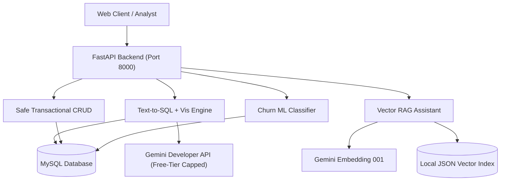

# AI-Powered Data Analyst — Master Project Guide

A full-stack, enterprise-grade business intelligence platform featuring:
- **Natural Language Text-to-SQL Interface** with automatic visualization recommendations (KPI, Bar, Line, Pie, Table).
- **Machine Learning Customer Churn Predictor** with Random Forest and feature-importance metrics.
- **Enterprise Retrieval-Augmented Generation (RAG)** answering document policies with grounded citations.
- **Controlled Safe CRUD Engine** featuring pre-execution row impact estimates and transactional rollback.
- **Production FastAPI Backend** with rate-limiting, CORS, and token-cost discipline.

---

## Architecture Overview



---

## 1. Setup & Environment

Ensure Python 3.10+ and Node.js are available.
Create your `.env` configuration file in the project root:

```ini
GEMINI_API_KEY=your_gemini_api_key
OPENROUTER_API_KEY=your_optional_fallback_key
MYSQL_USER=root
MYSQL_PASSWORD=your_password
MYSQL_HOST=localhost
MYSQL_PORT=3306
MYSQL_DATABASE=text_to_sql
```

Install dependencies:
```bash
pip install -r requirements.txt
```

---

## 2. Running the Application

### 2.1 Backend Server
Start the dedicated FastAPI application on port 8001:
```bash
python run_backend.py
```
Or with uvicorn directly:
```bash
python -m uvicorn main_api:app --host 0.0.0.0 --port 8001 --reload
```
Interactive OpenAPI documentation is available at: `http://localhost:8001/docs`

### 2.2 Frontend Application
```bash
cd frontend
npm install
npm run dev
```
The React interface runs on `http://localhost:5173`.

---

## 3. Deployment Guide (Vercel & Cloud)

### Frontend Deployment on Vercel
1. Push this repository to your GitHub account.
2. Sign in to [Vercel](https://vercel.com) and click **"Add New Project"**.
3. Import your GitHub repository.
4. If prompted for project settings:
   - **Framework Preset**: Vite
   - **Root Directory**: `frontend` (or `./` using the included `vercel.json`)
   - **Build Command**: `npm run build`
   - **Output Directory**: `dist`
5. Under **Environment Variables**, set:
   - `VITE_API_URL`: The public URL of your backend API (e.g. `https://your-backend.onrender.com/api` or your cloud tunnel).
6. Click **Deploy**.

---

## 3. Core API Endpoints

### 3.1 Analytics Query (`POST /api/query`)
**Request:**
```json
{
  "question": "What is the total sales amount for each channel?"
}
```
**Response:**
```json
{
  "success": true,
  "sql": "SELECT Channel, SUM(`Line Total`) FROM sales_order GROUP BY Channel",
  "records": [
    {"Channel": "Wholesale", "Total": 280171126.2},
    {"Channel": "Distributor", "Total": 162194022.1},
    {"Channel": "Export", "Total": 75540463.2}
  ],
  "visualization": {
    "type": "bar",
    "title": "Total by Channel",
    "xAxis": "Channel",
    "yAxis": "Total"
  },
  "explanation": "Wholesale generated the highest total sales at $280.17M, followed by Distributor and Export."
}
```

### 3.2 Machine Learning Churn Risk (`GET /api/ml/churn/high-risk?limit=5`)
Returns accounts at risk of severe quarterly contraction (>15% spend decline) based on the fitted Random Forest classifier.

### 3.3 Document RAG (`POST /api/rag/ask`)
**Request:**
```json
{
  "question": "According to the company refund policy, what is the refund period?"
}
```
**Response:**
```json
{
  "success": true,
  "answer": "All return requests must be submitted within 30 days of the recorded delivery date.",
  "sources": [{"doc_name": "company_policy.md", "similarity": 0.65}]
}
```

### 3.4 Safe CRUD Operations (`POST /api/crud/preview/create`, `/update`, `/delete`, `/confirm`)
Performs pre-execution row impact estimates and requires explicit confirmation:
- Restricts writes strictly to approved reference tables (`customers`, `products`, `2017_budgets`, `state_regions`).
- Prevents write operations on historical order tables.
- Employs atomic transaction rollbacks on failure.
